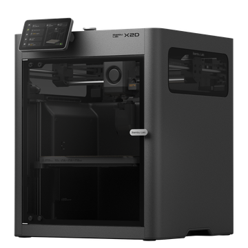
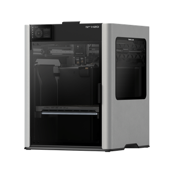

# 机型图片与视频的一致性检查

日期：2026-10-19。小工具版本保持1.0.1，Skill独立仓库不变。

| 检查对象 | 结论与处理 |
|---|---|
| A1 mini、A1、A2L、P1S、P2S、X2D、H2S、H2D、H2C | 统一恢复此前官网产品图；9/9与既有裁切和旧品牌包哈希一致 |
| 视频素材里的A1 mini、A1、P2S、X2D、H2D、H2C | 6/6与仓库恢复图片逐字节一致 |
| 推荐结果、全系能力图、机型详情 | 共用同一图片字段，统一改用PNG；删除“结构示意”旧图注，注明官网产品图 |
| 贝果角色、八张欢迎动作、E猫叫 | 已是选定版本，原字节保留；不重新生成 |
| 欢迎字幕 | 继续用当前系统字体绘制方案；历史栅格字层不恢复，避免将其未核字体来源改记为已核 |
| Logo与封面 | 属于独立发布/视频素材，当前H5未内嵌，不需要为机型换图引入额外大图 |
| 五轮题面、推荐规则、价格、笔记正文 | 不修改 |
| 默认构建、许可清单、校验、说明 | 同步修正，克隆后无需私人目录即可显示同款图片 |

图库示例：

照片版权归拓竹或原权利人。它们不是作者实拍，也不受本项目代码MIT或贝果自有素材CC BY-NC 4.0覆盖；项目不声称已获得厂商公开再分发授权。完整来源与哈希见licensing/product-images.json。

普通浏览器及软件校验不替代小红书创服模拟器、Android及iOS真机验证。此次不登录、上传或发布小红书。
